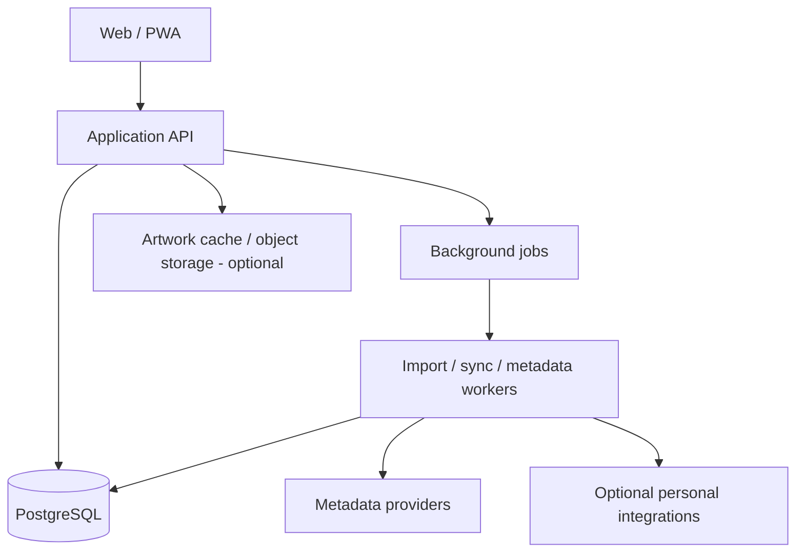

# OpenShelf — Self-Hosted Media & Experience Journal

> **Status:** Proposal / Request for Comments (RFC)  
> **Audience:** Friends, prospective users, and contributors  
> **Working name:** OpenShelf (subject to change)  
> **Last updated:** 2026-11-04

## The pitch

A self-hosted, multi-user home for tracking **what you own, what you want to experience, what you're currently enjoying, and what you thought of it** across games, books, movies, TV, music, and tabletop games.

Think of the experience of Backloggd, Goodreads, and Letterboxd, but with a unified library, a personal activity journal, optional social features, and integrations with tools you already use. This is **not** a media server or a replacement for Plex, Steam, or Calibre.

**This document is a design proposal, not an implementation commitment.** Feedback is welcome before the scope and architecture are finalized.

## Goals

1. **One home for many media types.** Search, catalog, rate, review, and track progress without maintaining separate services for every hobby.
2. **Separate collection from consumption.** Owning a game and finishing it are different facts; so are owning a book and reading it.
3. **Make logging enjoyable.** Attractive cover-driven browsing, fast updates, flexible lists, and a chronological journal.
4. **Self-host first.** Run with Docker Compose initially and support Kubernetes deployment without requiring a vendor cloud account for core features.
5. **Multi-user by design.** Independent accounts, per-user libraries, optional public profiles, and opt-in social sharing.
6. **Portable data.** Import where feasible and export all user-created content in documented formats.
7. **Extensible integrations.** Connect to external catalogs and activity sources without making the core application depend on them.

## Non-goals (initially)

- Hosting or streaming media files.
- Replacing Steam, Plex, Calibre, or music players.
- Building a public social network or recommendation algorithm at launch.
- Tracking every kind of life activity (restaurants, travel, workouts, etc.).
- Guaranteeing perfect synchronization with third-party services or scraping sites that do not provide supported APIs.

## Proposed media coverage

| Type | Key entities | Example tracking | Phase |
| --- | --- | --- | --- |
| Video games | Game, edition/platform | Backlog, playing, completed, abandoned, replayed; playthroughs | MVP |
| Books | Work, edition, series | To read, reading, finished, DNF; rereads; print/ebook/audio | MVP |
| Movies | Film, release | Watchlist, watched, rewatches | MVP |
| TV | Show, season, episode | Watching, completed, dropped; episode progress | MVP (basic) |
| Music | Artist, album, release | Listened, rated, favorites; optional listening history | Later |
| Tabletop | Board game, expansion, RPG | Owned, wishlist, session log, players | Later |
| Podcasts | Show, episode | Followed, listened, progress | Later |
| Comics/manga | Series, volume, issue | Read, collecting, progress | Later |
| Concerts | Artist, venue, event | Attended, wishlisted, memories | Exploration |

**Scope principle:** Start with four well-supported media types, not ten partially supported ones. A flexible model should make new types possible without pretending they all share identical workflows.

## Core user journeys

### 1. Add something to my library

- Search by title, creator, or external identifier (ISBN, Steam app ID, TMDB ID, etc.).
- Select the correct item and edition/platform when applicable.
- Mark **owned**, **wishlist**, **borrowed**, or **not owned** independently from consumption status.
- Set privacy and optional personal tags.
- Manually create an item when no metadata source has it.

### 2. Track an experience

- Start, pause, finish, abandon, or revisit an item.
- Record dates and progress appropriate to its type: pages, chapters, episodes, hours, or percentage.
- Create multiple sessions or playthroughs/readthroughs/watchings without overwriting history.
- Rate or review an item; record spoiler flags and visibility.

### 3. Explore my backlog

- Filter by media type, status, platform/format, genre, tags, length, rating, and date added.
- Sort and create custom lists, including mixed-media lists.
- See “currently enjoying,” “recently finished,” and a chronological activity feed.

### 4. Share with friends

- Public or invite-only profile, with private by default as a proposed starting point.
- Share a curated list or review without exposing the rest of the library.
- Optional follow/friend relationships in a later release.
- Never expose private notes or imported activity accidentally.

## Product design

### Primary navigation

- **Home:** Currently active items, recent activity, quick-add, backlog suggestions.
- **Library:** Unified cover grid/list with saved filters and media-type tabs.
- **Discover:** Search external catalogs and browse metadata.
- **Journal:** Timeline of starts, finishes, ratings, and reviews.
- **Lists:** Ranked/unranked, private/shared, mixed-media collections.
- **Profile:** Stats, favorites, year-in-review, visibility settings.
- **Settings:** Integrations, import/export, metadata preferences, account management.

### Item detail page

Cover/artwork, title, creators, release/publication information, genres, synopsis, source links, personal status, ownership, progress, logs, rating, review, and lists. Media-specific panels should appear only where relevant.

### UX principles

- Mobile-first responsive web app / installable PWA.
- Quick logging in a few taps; keyboard-friendly desktop experience.
- Accessible color contrast, keyboard navigation, and screen-reader labels.
- Graceful behavior when metadata providers are down.
- Explicit provenance when metadata was imported from an external source.

## Data model (conceptual)

**Do not use a single `status` field to represent ownership, progress, and activity.** These are separate concerns.

| Entity | Purpose |
| --- | --- |
| `User` | Identity, settings, visibility defaults |
| `MediaItem` | Canonical creative work (game, book, film, show, album, etc.) |
| `MediaEdition` | Optional platform, format, release, or edition details |
| `Creator` / `Credit` | People, studios, authors, artists, roles |
| `ExternalIdentifier` | Provider-specific IDs, URLs, and provenance |
| `UserLibraryEntry` | User-to-item relationship: owned, wishlist, acquired date, tags, notes |
| `Experience` | A distinct playthrough, reading, viewing, or listening journey |
| `ProgressEvent` | Time-stamped progress snapshots and completion events |
| `RatingReview` | User rating, review, spoiler flag, visibility |
| `Collection` / `CollectionItem` | Ordered or unordered lists across media types |
| `ActivityEvent` | User-facing journal event, linked to the underlying action |
| `IntegrationConnection` | Per-user integration configuration and sync state |
| `ImportJob` | Import status, errors, deduplication decisions, provenance |

**Relationships:** `MediaItem` has zero or more editions and external IDs; `User` has zero or more library entries, experiences, reviews, and collections. An `Experience` references a user and media item (and optionally an edition). An `ActivityEvent` references its originating record rather than duplicating the source of truth.

**Type-specific metadata:** Prefer explicit typed extension tables or validated structured fields for properties that genuinely differ. Avoid an unvalidated “everything JSON” model. TV episode hierarchy, book editions, and game platforms need deliberate treatment.

### Important edge cases

- One book work with several editions and audiobook formats.
- One game across PC and console, with separate ownership and playthroughs.
- A movie watched multiple times, with optional per-viewing notes.
- TV progress at both episode and show levels without conflicting state.
- A title renamed or merged by a metadata provider.
- Imports that repeat the same event or disagree with manually entered data.
- User ratings that change over time; preserve review edit history if desired.

## Proposed architecture



### Initial stack (proposed, open for discussion)

| Layer | Candidate | Why |
| --- | --- | --- |
| Frontend | Next.js + TypeScript | Responsive web app, rich UI, PWA support |
| API | NestJS + TypeScript **or** FastAPI + Python | Structured API; choose based on contributor preferences |
| Database | PostgreSQL | Relational integrity, search options, JSONB when appropriate |
| Jobs | Database-backed queue initially | Avoid Redis until workload justifies it |
| Authentication | Local accounts initially; OIDC optional | Self-hostable with Authentik and other providers |
| Deployment | Docker Compose first, Kubernetes manifests/Helm later | Easy contributor onboarding and homelab deployment |
| Observability | Structured logs, health endpoints, optional OpenTelemetry | Works with common self-hosted monitoring stacks |

**Architecture decision to settle:** One primary application service plus worker processes is likely sufficient. Avoid microservices until scale or team ownership demands them.

### Integration candidates

| Source | Proposed capability | Caveat |
| --- | --- | --- |
| Open Library | Book metadata and identifiers | Match editions carefully; respect service usage policies |
| Google Books | Supplemental book metadata | Quotas and terms apply |
| IGDB / RAWG | Game metadata | API access, attribution, and licensing require review |
| Steam | Owned games, playtime, achievements | Visibility, API access, and platform limitations apply |
| TMDB | Film/TV metadata | Attribution and terms apply |
| Plex / Tautulli | Viewing history and progress | User-specific tokens and duplicate events need handling |
| Calibre / Calibre-Web | Book collection import | Different integration surfaces |
| Audiobookshelf | Audiobook library and listening progress | Requires authorized access |
| MusicBrainz / ListenBrainz | Music metadata and listening events | Rate limits and identity matching |
| BoardGameGeek | Tabletop metadata and collection | API availability and terms require validation |
| setlist.fm | Concert and setlist history | API terms and completeness vary |
| Backloggd | Existing game collection import | No official integration assumed; investigate user export options |

**Integration policy:** Use documented APIs and authorized user exports. Never require users to give the app their passwords for third-party services. Store credentials encrypted, provide disconnect/delete controls, honor rate limits, and make all syncs idempotent.

## Privacy, security, and ownership

- Private by default for library entries, reviews, notes, and activity; allow granular opt-in sharing.
- Role-based administration without automatic access to private user content in ordinary UI flows.
- Strong session management, CSRF protections where applicable, input validation, and rate limiting.
- OIDC supported as an option, not a requirement; local login must remain usable.
- Secrets in environment/secret management, never in source control or logs.
- Secure backup/restore instructions, including database and artwork cache if used.
- Full user data export (JSON/CSV where appropriate) and account deletion.
- Clear license and attribution for third-party metadata and cover art; do not assume art can be redistributed or permanently cached.
- Review threats from public profiles, webhooks, imported HTML, and external image URLs (including SSRF and XSS).

## Suggested MVP

The first usable release should support:

1. Sign up / sign in (or admin-created accounts), profile, privacy defaults.
2. Game, book, film, and basic TV metadata search with manual fallback.
3. Add/remove library entries and independently track ownership and wishlist state.
4. Start/finish/abandon/revisit experiences; basic progress where meaningful.
5. Personal ratings and text reviews.
6. Unified library grid/list, filters, and cross-media custom lists.
7. Journal of recent activity and basic stats.
8. JSON export, initial CSV import format, backup/restore documentation.
9. Docker Compose deployment, health checks, migrations, and automated tests.

**MVP acceptance test:** A new user can deploy the app, add a game, a book, and a film; mark one owned but untouched; log finishing another; rate/review it; put all three in a shared list; export their data; and restore from backup without needing any proprietary cloud service for core functionality.

### Later milestones

**Milestone 2 — Sync:** Steam, Plex/Tautulli, Calibre/Audiobookshelf, background jobs, reconciliation UI, and import history.

**Milestone 3 — Breadth:** Music, tabletop, podcasts/comics, richer TV tracking, better analytics, and year-in-review.

**Milestone 4 — Social and discovery:** Friends/follows, recommendations, franchise/universe relationships, and optional local-AI natural-language discovery. AI must be optional, never required for basic functionality.

## Risks and decisions to validate

| Risk / question | Proposed mitigation |
| --- | --- |
| Scope creep across media types | MVP only four categories; extension contracts for future types |
| Inconsistent metadata quality | Manual corrections, provenance, merge tools, source priorities |
| Third-party API restrictions | Provider adapters, caching within terms, manual entry fallback |
| Duplicate imports and conflicting progress | Stable external IDs, idempotency keys, conflict review |
| TV/book/game hierarchy complexity | Model editions and episodic structures explicitly |
| Privacy leaks through sharing | Private defaults and visibility tests |
| Too much operational overhead | Compose first, minimal dependencies, simple worker design |
| Single maintainer bottleneck | Small, documented contribution surface and issue templates |

## Open questions for feedback

1. Which **three media categories** would make you use this immediately?
2. Is your primary motivation **collection inventory**, **experience tracking**, or **both**?
3. Which existing services would you most want to import from?
4. Do you care about logging **individual sessions**, or only start/finish dates?
5. Should ratings be 5 stars, 10 points, 100 points, or configurable?
6. Would you share a profile publicly, with friends only, or keep everything private?
7. Is multi-user support important from day one?
8. Should social features live inside the app, or should it remain mostly personal?
9. What is the one feature missing from Backloggd/Goodreads/Letterboxd that you'd want here?
10. Would you help test, design, or contribute code?

## Proposed repository layout

```text
openshelf/
├── README.md                 # This RFC, later shortened to project overview
├── docs/
│   ├── architecture.md       # Detailed architecture (after feedback)
│   ├── data-model.md         # Schema and domain rules
│   ├── integrations.md       # Provider-specific notes
│   └── decisions/            # Architecture decision records
├── apps/
│   ├── web/
│   ├── api/
│   └── worker/
├── deploy/
│   ├── compose/
│   └── kubernetes/
└── .github/
    ├── ISSUE_TEMPLATE/
    └── DISCUSSION_TEMPLATE/
```

This layout is illustrative, not a requirement to create all directories before implementation.

## How to give feedback

For now, please comment on this RFC or open a **GitHub Discussion** under one of these topics:

- **Feature ideas:** What's missing or unnecessary?
- **Use cases:** What would you personally track?
- **Integrations:** What data would you want imported?
- **Architecture:** Where is the design too complex or too limiting?
- **Contributing:** Would you like to help prototype or test?

When commenting, please distinguish **must-have for MVP** from **nice-to-have later**. The goal of this RFC is to reduce uncertainty before anyone starts building.

---

### Tentative success criteria

A successful first release is not the largest possible catalog. It's a pleasant, reliable app that a few real users choose to update regularly, that preserves their data, and that is easy enough to self-host that friends can try it without a weekend of infrastructure work.
