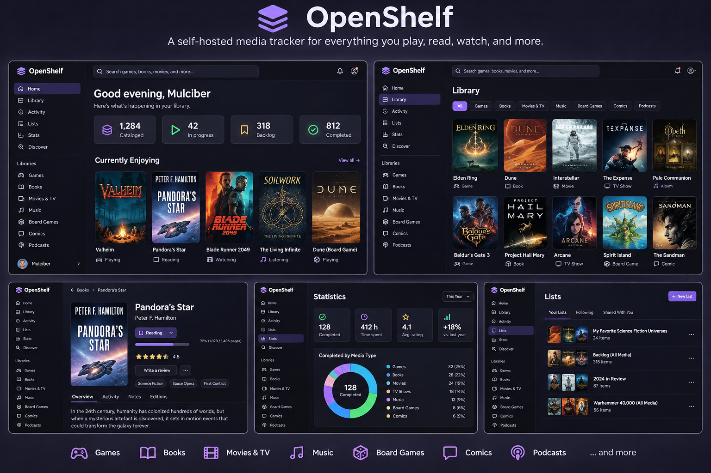
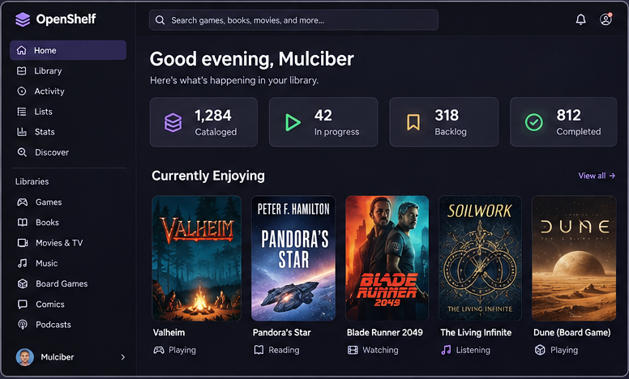
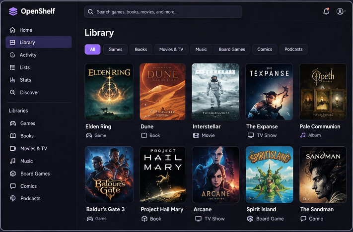
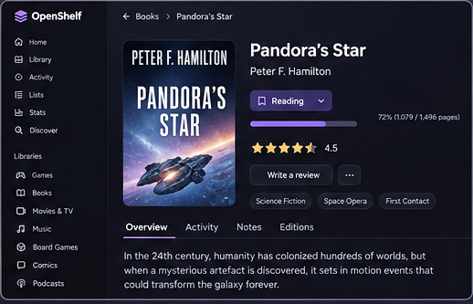
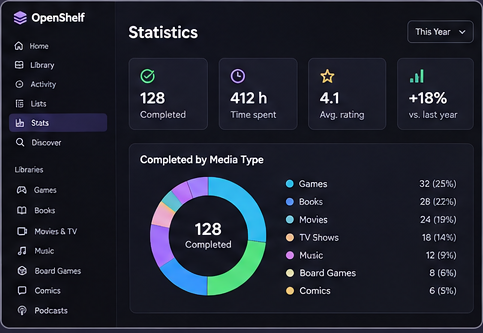
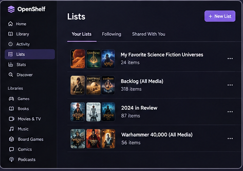
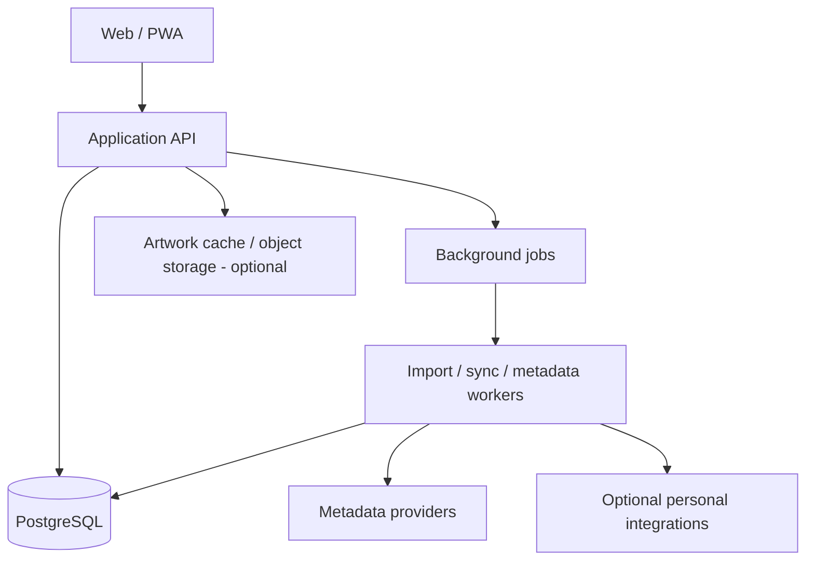
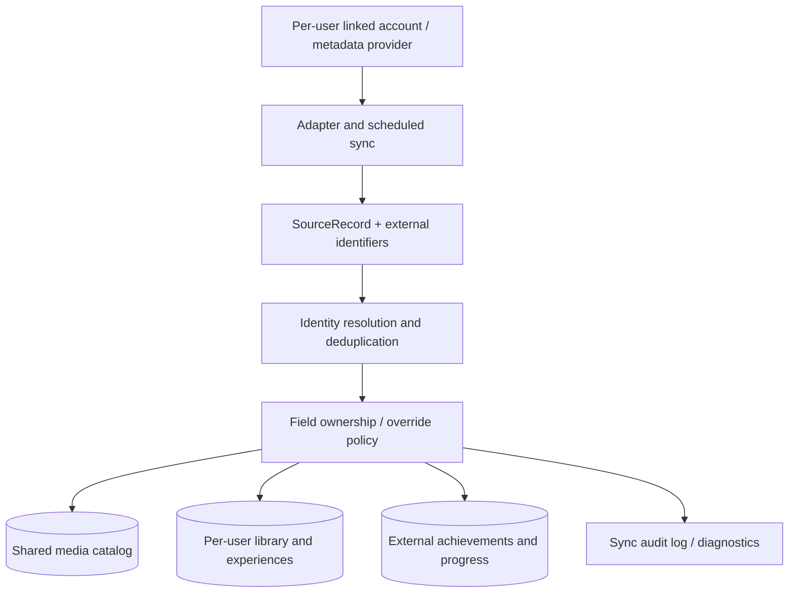

# OpenShelf — Self-Hosted Media & Experience Journal

> **Status:** Proposal / Request for Comments (RFC)  
> **Audience:** Friends, prospective users, and contributors  
> **Working name:** OpenShelf (subject to change)  
> **Last updated:** 2026-11-04

## The pitch

A self-hosted, multi-user home for tracking **what you own, what you want to experience, what you're currently enjoying, and what you thought of it** across games, books, movies, TV, music, and tabletop games.

Think of the experience of Backloggd, Goodreads, and Letterboxd, but with a unified library, a personal activity journal, optional social features, and integrations with tools you already use. This is **not** a media server or a replacement for Plex, Steam, or Calibre.

**This document is a design proposal, not an implementation commitment.** Feedback is welcome before the scope and architecture are finalized.

## Interface mockups

> **Early visual concepts, not implemented screens.** These AI-generated mockups illustrate the intended look and information architecture; artwork, titles, statistics, and interface details are illustrative and may change. Feedback on layout, density, accessibility, and navigation is especially welcome.



### Dashboard and library

The dashboard highlights active media, backlog, and recent activity. The library supports a combined view with filters by media type, status, and ownership.

| Dashboard | Unified library |
| --- | --- |
|  |  |

### Item details, statistics, and lists

An item page combines metadata with **your** status, progress, ratings, reviews, and history. Statistics summarize activity across media types; lists can combine books, games, films, and more.

| Item detail | Statistics | Lists |
| --- | --- | --- |
|  |  |  |

**Design questions:** Is the cover-first layout useful? Should the dashboard emphasize current activity or the backlog? Would you prefer a compact list/table view? What should be visible to other users by default?

## Goals

1. **One home for many media types.** Search, catalog, rate, review, and track progress without maintaining separate services for every hobby.
2. **Separate collection from consumption.** Owning a game and finishing it are different facts; so are owning a book and reading it.
3. **Make logging enjoyable.** Attractive cover-driven browsing, fast updates, flexible lists, and a chronological journal.
4. **Self-host first.** Run with Docker Compose initially and support Kubernetes deployment without requiring a vendor cloud account for core features.
5. **Multi-user by design.** Independent accounts, per-user libraries, optional public profiles, and opt-in social sharing.
6. **Portable data.** Import where feasible and export all user-created content in documented formats.
7. **Extensible integrations.** Connect to external catalogs and activity sources without making the core application depend on them.
8. **Automatic imports with user authority.** Newly discovered items appear automatically, but later syncs never erase explicit personal choices.
9. **Federation-ready, multi-user instances.** Each independently operated server hosts many users, with optional cross-instance social connections.

## Non-goals (initially)

- Hosting or streaming media files.
- Replacing Steam, Plex, Calibre, or music players.
- Building a public social network or recommendation algorithm at launch.
- Tracking every kind of life activity (restaurants, travel, workouts, etc.).
- Guaranteeing perfect synchronization with third-party services or scraping sites that do not provide supported APIs.

## Proposed media coverage

| Type | Key entities | Example tracking | Phase |
| --- | --- | --- | --- |
| Video games | Game, edition/platform | Backlog, playing, completed, abandoned, replayed; playthroughs | MVP |
| Books | Work, edition, series | To read, reading, finished, DNF; rereads; print/ebook/audio | MVP |
| Movies | Film, release | Watchlist, watched, rewatches | MVP |
| TV | Show, season, episode | Watching, completed, dropped; episode progress | MVP (basic) |
| Music | Artist, album, release | Listened, rated, favorites; optional listening history | Later |
| Tabletop | Board game, expansion, RPG | Owned, wishlist, session log, players | Later |
| Podcasts | Show, episode | Followed, listened, progress | Later |
| Comics/manga | Series, volume, issue | Read, collecting, progress | Later |
| Concerts | Artist, venue, event | Attended, wishlisted, memories | Exploration |

**Scope principle:** Start with four well-supported media types, not ten partially supported ones. A flexible model should make new types possible without pretending they all share identical workflows.

## Core user journeys

### 1. Add something to my library

- Search by title, creator, or external identifier (ISBN, Steam app ID, TMDB ID, etc.).
- Select the correct item and edition/platform when applicable.
- Mark **owned**, **wishlist**, **borrowed**, or **not owned** independently from consumption status.
- Set privacy and optional personal tags.
- Manually create an item when no metadata source has it.

### 2. Track an experience

- Start, pause, finish, abandon, or revisit an item.
- Record dates and progress appropriate to its type: pages, chapters, episodes, hours, or percentage.
- Create multiple sessions or playthroughs/readthroughs/watchings without overwriting history.
- Rate or review an item; record spoiler flags and visibility.

### 3. Explore my backlog

- Filter by media type, status, platform/format, genre, tags, length, rating, and date added.
- Sort and create custom lists, including mixed-media lists.
- See “currently enjoying,” “recently finished,” and a chronological activity feed.

### 4. Share with friends

- Public or invite-only profile, with private by default as a proposed starting point.
- Share a curated list or review without exposing the rest of the library.
- Optional follow/friend relationships in a later release.
- Never expose private notes or imported activity accidentally.

## Product design

### Primary navigation

- **Home:** Currently active items, recent activity, quick-add, backlog suggestions.
- **Library:** Unified cover grid/list with saved filters and media-type tabs.
- **Discover:** Search external catalogs and browse metadata.
- **Journal:** Timeline of starts, finishes, ratings, and reviews.
- **Lists:** Ranked/unranked, private/shared, mixed-media collections.
- **Profile:** Stats, favorites, year-in-review, visibility settings.
- **Settings:** Integrations, import/export, metadata preferences, account management.

### Item detail page

Cover/artwork, title, creators, release/publication information, genres, synopsis, source links, personal status, ownership, progress, logs, rating, review, and lists. Media-specific panels should appear only where relevant.

### UX principles

- Mobile-first responsive web app / installable PWA.
- Quick logging in a few taps; keyboard-friendly desktop experience.
- Accessible color contrast, keyboard navigation, and screen-reader labels.
- Graceful behavior when metadata providers are down.
- Explicit provenance when metadata was imported from an external source.

## Data model (conceptual)

**Do not use a single `status` field to represent ownership, progress, and activity.** These are separate concerns.

| Entity | Purpose |
| --- | --- |
| `User` | Identity, settings, visibility defaults |
| `MediaItem` | Canonical creative work (game, book, film, show, album, etc.) |
| `MediaEdition` | Optional platform, format, release, or edition details |
| `Creator` / `Credit` | People, studios, authors, artists, roles |
| `ExternalIdentifier` | Provider-specific IDs, URLs, and provenance |
| `UserLibraryEntry` | User-to-item relationship: owned, wishlist, acquired date, tags, notes |
| `Experience` | A distinct playthrough, reading, viewing, or listening journey |
| `ProgressEvent` | Time-stamped progress snapshots and completion events |
| `RatingReview` | User rating, review, spoiler flag, visibility |
| `Collection` / `CollectionItem` | Ordered or unordered lists across media types |
| `ActivityEvent` | User-facing journal event, linked to the underlying action |
| `IntegrationConnection` | Per-user integration configuration and sync state |
| `ImportJob` | Import status, errors, deduplication decisions, provenance |
| `ExternalAccount` | Per-user link to a provider account, including SteamID and consent/scope |
| `SourceRecord` | Raw/normalized provider observations, timestamps and source identifiers |
| `FieldOverride` | Explicit user-owned values and override timestamps per field |
| `GameAchievement` / `UserAchievement` | Game achievement definitions and per-external-account unlock state |
| `Platform` / `GameRelease` | Platform registry and platform/region-specific releases; see retro section |
| `FederatedActor` / `RemoteFollow` | Local/remote identities, follow requests and relationships |

**Relationships:** `MediaItem` has zero or more editions and external IDs; `User` has zero or more library entries, experiences, reviews, and collections. An `Experience` references a user and media item (and optionally an edition). An `ActivityEvent` references its originating record rather than duplicating the source of truth.

**Type-specific metadata:** Prefer explicit typed extension tables or validated structured fields for properties that genuinely differ. Avoid an unvalidated “everything JSON” model. TV episode hierarchy, book editions, and game platforms need deliberate treatment.

### Important edge cases

- One book work with several editions and audiobook formats.
- One game across PC and console, with separate ownership and playthroughs.
- A movie watched multiple times, with optional per-viewing notes.
- TV progress at both episode and show levels without conflicting state.
- A title renamed or merged by a metadata provider.
- Imports that repeat the same event or disagree with manually entered data.
- User ratings that change over time; preserve review edit history if desired.

## Proposed architecture



### Initial stack (proposed, open for discussion)

| Layer | Candidate | Why |
| --- | --- | --- |
| Frontend | Next.js + TypeScript | Responsive web app, rich UI, PWA support |
| API | NestJS + TypeScript **or** FastAPI + Python | Structured API; choose based on contributor preferences |
| Database | PostgreSQL | Relational integrity, search options, JSONB when appropriate |
| Jobs | Database-backed queue initially | Avoid Redis until workload justifies it |
| Authentication | Local accounts initially; OIDC optional | Self-hostable with Authentik and other providers |
| Deployment | Docker Compose first, Kubernetes manifests/Helm later | Easy contributor onboarding and homelab deployment |
| Observability | Structured logs, health endpoints, optional OpenTelemetry | Works with common self-hosted monitoring stacks |

**Architecture decision to settle:** One primary application service plus worker processes is likely sufficient. Avoid microservices until scale or team ownership demands them.

### Integration candidates

| Source | Proposed capability | Caveat |
| --- | --- | --- |
| Open Library | Book metadata and identifiers | Match editions carefully; respect service usage policies |
| Google Books | Supplemental book metadata | Quotas and terms apply |
| IGDB / RAWG | Game metadata | API access, attribution, and licensing require review |
| Steam | Owned games, playtime, achievements | OpenID 2.0 for sign-in; data APIs and visibility limits apply |
| RetroAchievements | Retro game achievement unlocks, hardcore/softcore progress, mastery | API-key-based access; game/system coverage is incomplete |
| MobyGames / ScreenScraper | Supplemental retro platform, release, artwork metadata | Access, quotas, licensing and attribution must be checked |
| RetroArch / ES-DE / Playnite / LaunchBox | Optional local retro library imports | Phase 2; prefer supported exports or documented APIs |
| TMDB | Film/TV metadata | Attribution and terms apply |
| Plex / Tautulli | Viewing history and progress | User-specific tokens and duplicate events need handling |
| Calibre / Calibre-Web | Book collection import | Different integration surfaces |
| Audiobookshelf | Audiobook library and listening progress | Requires authorized access |
| MusicBrainz / ListenBrainz | Music metadata and listening events | Rate limits and identity matching |
| BoardGameGeek | Tabletop metadata and collection | API availability and terms require validation |
| setlist.fm | Concert and setlist history | API terms and completeness vary |
| Backloggd | Existing game collection import | No official integration assumed; investigate user export options |

**Integration policy:** Use documented APIs and authorized user exports. Never require users to give the app their passwords for third-party services. Store credentials encrypted, provide disconnect/delete controls, honor rate limits, and make all syncs idempotent.

## Integration architecture and synchronization contract

**Decision: automatically import newly discovered items.** Once an account is connected, newly discovered owned games, books, or watched titles are added to the relevant user's library without an approval queue. A new import is **private by default**, does not imply the person personally consumed the item, and never automatically publishes a federated activity. Users can disable a connection or exclude individual source items; exclusions must survive future syncs.

### Metadata discovery versus personal account sync

| Domain | Primary candidate | Fallback / additional source | Notes |
| --- | --- | --- | --- |
| Books | Open Library | Google Books | Resolve works versus editions; ISBN is edition-specific |
| Movies | TMDB | OMDb | Stable provider IDs, attribution and image licensing |
| TV shows and episodes | TMDB | TVDB | Season/episode identity and provider remapping |
| Video games | IGDB | RAWG | Game/platform/edition matching; IGDB application credentials via Twitch |
| Music (later) | MusicBrainz | Cover Art Archive | Separate recordings, releases and release groups |
| Board games (later) | BoardGameGeek | Manual entry | Expansions and editions are distinct |

Metadata adapters enrich the **instance-shared catalog**; account adapters import **user-specific ownership, history, progress and achievements**. Provider IDs must be stored as namespaced external identifiers, not used as OpenShelf primary keys. Allow manual correction and record provenance, source priority, attribution, API quotas, and caching restrictions. A title match alone is never sufficient to merge ambiguous editions.

### Adapter contract

Each adapter declares its capabilities (`catalog`, `ownership`, `activity`, `progress`, `achievements`, `incremental_sync`, `webhooks`) and implements, where applicable: account authorization, paginated fetch, normalization, stable source IDs, cursor/checkpoint storage, retry/backoff, rate limiting, and disconnect. A background worker processes source records through identity resolution, a field-level merge policy, and an auditable change log. Sync must be idempotent and safe to resume after interruption.



### Field-level merge and override policy

**External observations are not the same as a user's personal assertions.** Store the provider's most recent value separately from the effective value displayed in OpenShelf. When a user explicitly edits a field, set a durable override marker; subsequent imports update the source snapshot but **must not overwrite that effective value**. Provide *Reset to source* to clear a specific override. Manual ratings, reviews, notes, collections, and personal activity are always user-owned.

| Field | Initial import behavior | Future sync behavior |
| --- | --- | --- |
| Owned game / library membership | Auto-add as source-owned | Update source ownership; do not delete a personal entry on disappearance |
| Played / not played | May infer from reported playtime, labeled as inferred | Respect explicit manual value forever until reset |
| Playing / completed / abandoned | Prefer explicit user action; optional initial inference | Never replace manual status |
| Wishlist / personal backlog | Do not infer from ownership alone | User-owned |
| Playtime / last played | Store provider-reported figures with account attribution | Refresh external figures; don't conflate with personal sessions |
| Achievements and unlock timestamps | Import where available | Refresh from source; no manual override requirement |
| Rating / review / notes | Never infer | User-owned |
| Descriptive metadata | Enrich from preferred provider | Refresh unless manually corrected |

**Example:** Steam reports 30 hours in Portal 2 because a child used the account. OpenShelf initially infers `played=true`. The user changes it to `played=false`, creating a `FieldOverride`. Next Steam sync updates playtime and achievements but leaves `played=false`. A *Reset to source* action can restore inference. Changes should be inspectable in a sync history screen.

Additional safeguards: missing items are not deleted; imported events use provider event IDs or stable deduplication keys; transient errors never clear values; user-deleted/excluded imports stay excluded; account unlinking offers an explicit choice to retain or remove imported data; provider corrections may reconcile provider-owned history but never manual entries. Preserve attribution for shared household accounts.

### Steam integration — authentication and achievements

Steam website sign-in uses **OpenID 2.0**, **not OAuth 2.0**. Verify the signed assertion and bind the returned SteamID to an existing authenticated OpenShelf user; do not treat a Steam login as authorization to access all Steam Web API data. The server may also need an administrator-configured Steam Web API key. Respect profile/game-details privacy and endpoint availability; show partial sync results instead of pretending inaccessible data is empty.

- Link or unlink a SteamID per OpenShelf user, with optional multiple Steam accounts and explicit account attribution.
- Automatically import owned games using stable Steam App IDs, resolving them to catalog games via cross-provider mappings.
- Sync playtime and last-played information when available, keeping them separate from user-confirmed experience history.
- Sync game achievement definitions, per-account unlock state, counts, and timestamps when supplied by the API; refresh them on subsequent syncs.
- Do not infer *personal* play or completion from Steam achievements or playtime after a user has overridden that status.
- Support manual sync, scheduled incremental sync, pagination, backoff, and a visible per-game sync timestamp/error state.
- Never publish imported play events to federated friends without a separate, explicit user sharing action or opt-in policy.

**Acceptance test:** Import a Steam library; manually mark a game *Not Played*; simulate a later Steam sync reporting increased playtime and new achievements. The personal status remains *Not Played*, the source playtime and achievements advance, and the audit log records that the status override was respected.

### Multi-user connection boundaries

An instance hosts multiple local users. Each user's linked accounts, tokens, import preferences, exclusions, and source observations are isolated by user/account ID. Shared catalog metadata is cached once per instance, but no user's personal state is shared implicitly. Administrators enable/configure adapters and application API credentials; users authorize their own accounts. OIDC for **OpenShelf login** (including Authentik) is separate from Steam OpenID account linking. An external account shared by household members must be explicitly linked and must not automatically assign its playtime or achievements to each person's personal experiences.

### Recommended integration rollout

| Release | Integrations |
| --- | --- |
| MVP | Open Library, TMDB, IGDB metadata; retro platform registry and platform browsing; Steam OpenID linking and owned-game import; Steam achievements; RetroAchievements linking and achievement import; field-level overrides; JSON/CSV import/export |
| Next | Plex/Tautulli (map Plex users), Calibre/Calibre-Web, Audiobookshelf, Trakt, Jellyfin/Emby |
| Later | GOG/Epic/console sources where access permits; Goodreads/StoryGraph/Hardcover imports; MusicBrainz/ListenBrainz/Last.fm; BoardGameGeek; Kavita/Komga; SteamGridDB |

No unsupported API or scraping method is assumed. Integration availability, terms, quotas and licenses must be verified during implementation.

## Retro gaming: comprehensive platforms and RetroAchievements (MVP)

**Problem reported by early reviewers:** Backloggd's platform filter omits important retro systems, including the **Sega Dreamcast**. OpenShelf must not make its game discovery experience dependent on a single provider's platform list.

### Platform catalog and browsing

- Maintain an **OpenShelf-owned platform registry** with stable internal IDs, display names, aliases, manufacturer, hardware family, generation, original release era, and external provider mappings. Include Dreamcast, Saturn, Master System, Genesis/Mega Drive, Game Gear, NES, SNES, N64, GameCube, Game Boy families, PlayStation generations, Atari families, arcade boards, DOS, Amiga, Commodore 64 and other retro computers. This is an illustrative seed list, **not** a closed allowlist.
- Administrators can create or correct missing platforms and aliases; provider refreshes must not erase local corrections. Provide a way to flag platform metadata mistakes for later review.
- Support **browse all known releases for a platform**, not just games in a user's library. Filters combine platform, region, release year, genre, collection status, ownership, played state, and achievement availability. Clearly indicate when provider coverage is incomplete; do not imply the catalog is exhaustive.
- Model `Game` (conceptual title), `GameRelease` (platform/region/edition/release), and `Platform` separately. `GameRelease` can have multiple source identifiers; user ownership and experiences may reference a specific release. Do not confuse original platform with emulated or current play device.
- Normalize aliases such as `Genesis` / `Mega Drive`, while retaining distinctions between genuinely different platforms and versions. A game's PC, Dreamcast and PS2 releases may share a parent title but differ in content and achievements.
- Start with IGDB; supplement gaps with MobyGames and/or ScreenScraper where permitted. Store provider provenance, licensing, last-seen timestamps, and local overrides. Support manual entries when all providers lack a title or platform.

### RetroAchievements connection and sync

- Users connect their own RetroAchievements account using the **documented API-key flow** (not Steam OpenID or assumed OAuth). Never request the user's RetroAchievements password. Store API credentials encrypted and provide revoke/disconnect controls.
- Import supported game associations, achievement definitions, unlocked achievements and unlock timestamps, hardcore/softcore distinctions, points and mastery/completion awards **where the API provides them**. Report unavailable fields honestly; never infer mastery solely from a percentage if the service's award rules differ.
- Match RetroAchievements game IDs to OpenShelf game releases using provider IDs, system mappings and verified title evidence. Ambiguous matches go into a review queue; never silently merge similarly named games across consoles or regions.
- Sync achievements and awards as **external account facts**. They can update on subsequent syncs, while user-authored `played`, `completed`, rating, notes, backlog and visibility overrides remain authoritative. An achievement unlock does **not** prove the linked OpenShelf user personally played a shared emulator or account.
- Automatically add newly discovered, reliably matched games to the connecting user's library by default; uncertain matches are held for resolution. Newly imported activity stays private unless the user explicitly shares it.
- Maintain sync checkpoints, idempotent upserts, retry/backoff, rate-limit compliance, partial-failure reporting and an audit trail. A failed API response or missing title must not delete a local entry.
- Achievement records are keyed by **external account + provider game ID + achievement ID**, not merely by game title. Distinguish achievement unlock timestamps from local play-session timestamps.

### Retro-specific data additions

| Entity | Purpose |
| --- | --- |
| `Platform` / `PlatformAlias` | Canonical platform identity, aliases, family and metadata |
| `PlatformExternalIdentifier` | IGDB, MobyGames, ScreenScraper, RetroAchievements system IDs |
| `GameRelease` | Platform-specific game edition, region and release information |
| `GameReleaseExternalIdentifier` | Provider mappings for specific game releases |
| `AchievementSourceAccount` | Per-user linked Steam/RetroAchievements source and credentials reference |
| `AchievementUnlock` / `AchievementAward` | Source-scoped unlocks, mode and provider-awarded completion/mastery |
| `PlatformMetadataOverride` | Locally curated corrections protected from provider refresh |

### Acceptance criteria

1. Dreamcast is searchable and selectable even if the primary provider omits it.
2. Users can browse a Dreamcast release catalog independently of their personal collection, and filter it by ownership or played status.
3. The same title released on Dreamcast and PlayStation 2 can be tracked as separate releases without duplicate canonical games.
4. A user connects RetroAchievements and sees available achievements, unlocks, hardcore/softcore progress and mastery awards for correctly matched releases.
5. After a user manually marks an imported game **Not Played**, later RetroAchievements or Steam syncs update external achievements without changing that personal status.
6. A missing platform or game can be added manually and survives metadata refreshes.
7. Two users on one OpenShelf instance can link different RetroAchievements accounts without leaking credentials or achievement histories across profiles.
8. A federated friend can view an explicitly shared retro-game review, while private imported achievements remain private.

## Multi-user federation requirements

Each OpenShelf server is independently operated and supports multiple local accounts. Federation is optional per instance, with per-user privacy controls. Design stable actor URLs and account identifiers from day one; target **ActivityPub** for cross-instance follows, requests, accepts, reviews, and public activity. A mutual friendship is an application-level relationship built on accepted follows, not a built-in ActivityPub primitive. Remote media matching uses cross-provider identifiers and never blindly merges items by title. Private imported data is not federated by default. Federation requires HTTPS, signed request verification, outbound SSRF protections, moderation/blocking, asynchronous delivery and retries. Other ActivityPub implementations may support only a subset of OpenShelf-specific objects.

**Federation acceptance test:** Two publicly reachable instances each host at least two users. A user on server A discovers and follows a user on server B, receives accepted public activity, while another user's private library and imported Steam history remain inaccessible. Server B going offline must not block local operations.

## Privacy, security, and ownership

- Private by default for library entries, reviews, notes, and activity; allow granular opt-in sharing.
- Role-based administration without automatic access to private user content in ordinary UI flows.
- Strong session management, CSRF protections where applicable, input validation, and rate limiting.
- OIDC supported as an option, not a requirement; local login must remain usable.
- Secrets in environment/secret management, never in source control or logs.
- Secure backup/restore instructions, including database and artwork cache if used.
- Full user data export (JSON/CSV where appropriate) and account deletion.
- Clear license and attribution for third-party metadata and cover art; do not assume art can be redistributed or permanently cached.
- Review threats from public profiles, webhooks, imported HTML, and external image URLs (including SSRF and XSS).

## Suggested MVP

The first usable release should support:

1. Sign up / sign in (or admin-created accounts), profile, privacy defaults.
2. Game, book, film, and basic TV metadata search with manual fallback.
3. Add/remove library entries and independently track ownership and wishlist state.
4. Start/finish/abandon/revisit experiences; basic progress where meaningful.
5. Personal ratings and text reviews.
6. Unified library grid/list, filters, and cross-media custom lists.
7. Journal of recent activity and basic stats.
8. JSON export, initial CSV import format, backup/restore documentation.
9. Docker Compose deployment, health checks, migrations, and automated tests.
10. Steam OpenID linking, automatic game import, achievement synchronization, and durable manual field overrides.
11. Retro console/platform browsing (including Dreamcast), platform-aware game releases, and RetroAchievements account linking and achievement sync.
12. Multi-user instance isolation and federation-ready actor identifiers; working two-instance federation before public beta.

**MVP acceptance test:** A new user can deploy the app, add a game, a book, and a film; mark one owned but untouched; log finishing another; rate/review it; put all three in a shared list; export their data; and restore from backup without needing any proprietary cloud service for core functionality.

### Later milestones

**Milestone 2 — Additional sync:** Plex/Tautulli, Calibre/Audiobookshelf, retro launcher/emulator collection imports (RetroArch, ES-DE, Playnite, LaunchBox where supported), background jobs, richer reconciliation UI, and import history.

**Milestone 3 — Breadth:** Music, tabletop, podcasts/comics, richer TV tracking, better analytics, and year-in-review.

**Milestone 4 — Social and discovery:** Full ActivityPub cross-instance friendships and activity before public beta; later shared lists, recommendations, franchise/universe relationships, and optional local-AI natural-language discovery. AI must be optional, never required for basic functionality.

## Risks and decisions to validate

| Risk / question | Proposed mitigation |
| --- | --- |
| Scope creep across media types | MVP only four categories; extension contracts for future types |
| Inconsistent metadata quality | Manual corrections, provenance, merge tools, source priorities |
| Third-party API restrictions | Provider adapters, caching within terms, manual entry fallback |
| Duplicate imports and conflicting progress | Stable external IDs, idempotency keys, conflict review |
| TV/book/game hierarchy complexity | Model editions and episodic structures explicitly |
| Privacy leaks through sharing | Private defaults and visibility tests |
| Too much operational overhead | Compose first, minimal dependencies, simple worker design |
| Single maintainer bottleneck | Small, documented contribution surface and issue templates |

## Open questions for feedback

1. Which **three media categories** would make you use this immediately?
2. Is your primary motivation **collection inventory**, **experience tracking**, or **both**?
3. Which existing services would you most want to import from?
4. Do you care about logging **individual sessions**, or only start/finish dates?
5. Should ratings be 5 stars, 10 points, 100 points, or configurable?
6. Would you share a profile publicly, with friends only, or keep everything private?
7. Is multi-user support important from day one?
8. Should social features live inside the app, or should it remain mostly personal?
9. What is the one feature missing from Backloggd/Goodreads/Letterboxd that you'd want here?
10. Would you help test, design, or contribute code?

## Proposed repository layout

```text
openshelf/
├── README.md                 # This RFC, later shortened to project overview
├── images/                   # Concept mockups used by README
├── docs/
│   ├── architecture.md       # Detailed architecture (after feedback)
│   ├── data-model.md         # Schema and domain rules
│   ├── integrations.md       # Provider-specific notes
│   └── decisions/            # Architecture decision records
├── apps/
│   ├── web/
│   ├── api/
│   └── worker/
├── deploy/
│   ├── compose/
│   └── kubernetes/
└── .github/
    ├── ISSUE_TEMPLATE/
    └── DISCUSSION_TEMPLATE/
```

This layout is illustrative, not a requirement to create all directories before implementation.

## How to give feedback

For now, please comment on this RFC or open a **GitHub Discussion** under one of these topics:

- **Feature ideas:** What's missing or unnecessary?
- **Use cases:** What would you personally track?
- **Integrations:** What data would you want imported?
- **Architecture:** Where is the design too complex or too limiting?
- **Contributing:** Would you like to help prototype or test?

When commenting, please distinguish **must-have for MVP** from **nice-to-have later**. The goal of this RFC is to reduce uncertainty before anyone starts building.

---

### Tentative success criteria

A successful first release is not the largest possible catalog. It's a pleasant, reliable app that a few real users choose to update regularly, that preserves their data, and that is easy enough to self-host that friends can try it without a weekend of infrastructure work.
